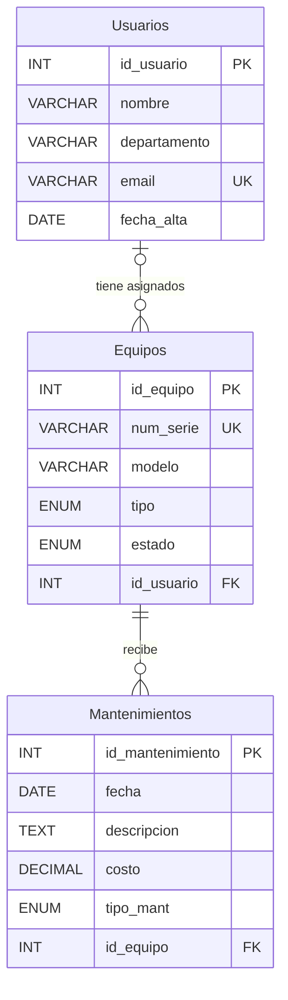

# Práctica 1 (Parte 1) — TechTrack Pro

**Universidad Privada del Estado de México (UPEM)**  
**Asignatura:** Bases de Datos Relacionales  
**Docente:** Ing. Roberto Carlos Hurtado Torres  
**Alumno:** Juan Carlos Vazquez Licona  
**Matrícula:** 241090003  
**Grupo:** 7 A

## Objetivo

Reproducir en MySQL el ejemplo guiado **TechTrack Pro** del documento «2do Parcial - Práctica 1», secciones 2.1 a 2.5 (páginas 2–9). El sistema registra usuarios, equipos de TI y mantenimientos mediante una base relacional con integridad referencial.

## Entrega y evidencias reales

El directorio `evidencias/` reúne las **11 capturas reales** tomadas en MySQL Workbench durante esta práctica (creación + consultas 1 a 10). El documento `Evidencias_TechTrack_Pro_Parte1.pdf` integra las capturas y las 12 respuestas guiadas para una entrega rápida en Classroom.

**Resultados observados:** primera carga de 3 usuarios, 4 equipos y 3 mantenimientos; consulta 1 agregó un equipo; consulta 2 modificó un usuario; consulta 3 eliminó un mantenimiento; consultas 4 a 10 mostraron respectivamente 5, 3, 3, 4, 1, 2 y 3 filas.

**Aclaración sobre los errores visibles en las capturas:** durante la consulta 1 hubo una repetición de `INSERT` que generó un duplicado (error 1062) y una prueba incompleta que generó el error 1064; el `INSERT` inicial fue exitoso. En la consulta 3 se mostró el error 1175 por el modo seguro antes de la ejecución exitosa del `DELETE`. Los resultados de éxito están señalados con indicadores verdes de Workbench.

## Archivos

- `01_creacion_y_datos.sql`: crea `TechTrackDB`, sus tres tablas y los datos de prueba originales. **Ejecutar una sola vez**, sobre una base nueva.
- `02_consultas_del_ejemplo.sql`: contiene las **10 consultas** del ejemplo (INSERT, UPDATE, DELETE, SELECT, filtros, JOIN y GROUP BY).
- `03_respuestas_preguntas_guiadas.md`: respuestas razonadas para las 12 preguntas de la Parte 1.
- `04_diagrama_casos_uso.puml`: fuente PlantUML de los ocho casos de uso y tres actores del ejemplo.
- `Evidencias_TechTrack_Pro_Parte1.pdf`: informe con capturas reales y respuestas a las 12 preguntas.
- `evidencias/`: archivos PNG originales ordenados de 00 a 10.

## Modelo Entidad-Relación

- Un usuario tiene asignados de cero a muchos equipos (`Usuarios` → `Equipos`, 1:N). `Equipos.id_usuario` puede ser `NULL`.
- Un equipo puede tener de cero a muchos mantenimientos (`Equipos` → `Mantenimientos`, 1:N).
- La FK `Equipos.id_usuario` utiliza `ON DELETE SET NULL` y `ON UPDATE CASCADE`.
- La FK `Mantenimientos.id_equipo` utiliza `ON DELETE CASCADE` y `ON UPDATE CASCADE`.

## Cómo ejecutar en MySQL Workbench

1. Abrir MySQL Workbench e ingresar a la conexión local.
2. Abrir `01_creacion_y_datos.sql` y ejecutar el script completo con el botón del rayo. Al terminar deben aparecer **3 usuarios, 4 equipos y 3 mantenimientos**.
3. En el panel **SCHEMAS** actualizar (Refresh All) y expandir `TechTrackDB` > `Tables`.
4. Abrir `02_consultas_del_ejemplo.sql`. Ejecutar las consultas en orden **una por una**. **Las primeras tres modifican registros**; repetirlas alteraría la evidencia o causaría errores.
5. Tomar capturas del panel `SCHEMAS`, resultados de creación/inserciones y algunas de las consultas (`SELECT`, `JOIN`, `GROUP BY`).
6. Subir los archivos sueltos y las capturas al repositorio GitHub de Bases de Datos Relacionales. Realizar un commit como `feat: practica 1 parte 1 TechTrack Pro`.

> **Nota:** Las evidencias en PNG son capturas reales aportadas por el alumno de su ejecución en MySQL Workbench; no son simulaciones. No ejecutar repetidamente las sentencias INSERT, UPDATE o DELETE si se pretende conservar el resultado documentado.

## Alcance de entrega

En Classroom se pidió realizar el **EJEMPLO** y adjuntar captura o enlace del repositorio. El desarrollo separado **LabTrack Pro** del documento corresponde a la Parte 2.
